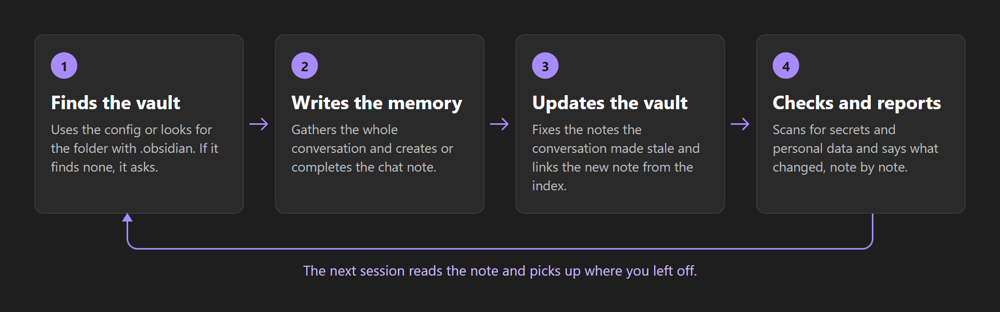
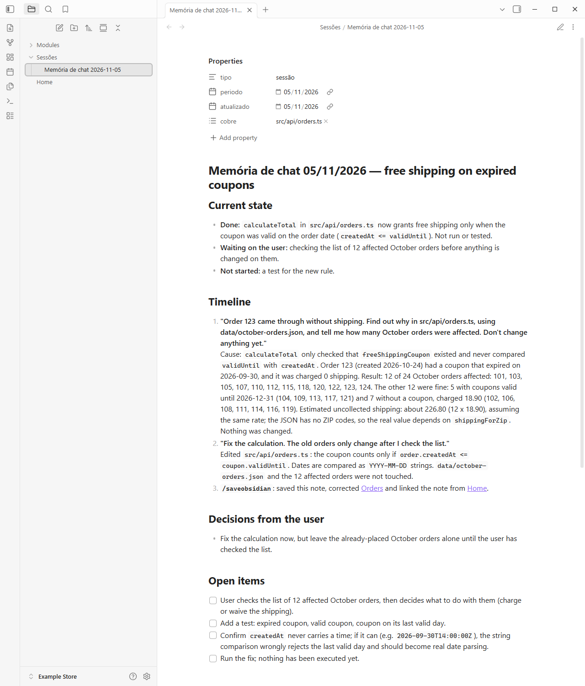
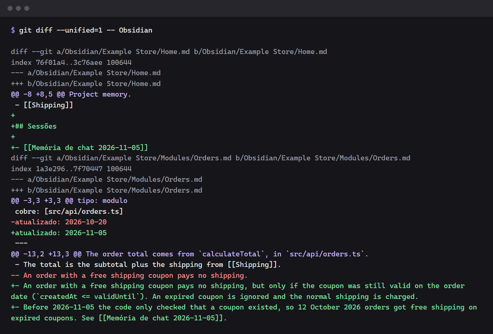
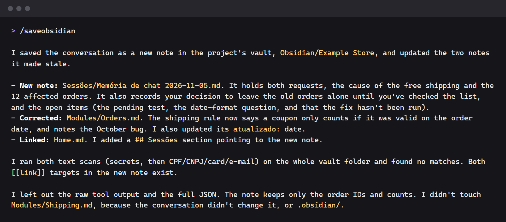

# `/saveobsidian` — save your AI conversation to Obsidian

[Português](README.md) · **English** · [Español](README.es.md)

The conversation with the AI ends, and what was decided in it goes too. This skill turns the chat
into a note in your **Obsidian** vault: what was asked, what was done, what was wrong and got
corrected, what you decided and what's still open. The next session reads the note and picks up
where you left off.

It works in **any project**, in any language. It's a single Markdown file, with no dependencies and
no required configuration.

> **Language note:** the skill's instructions are in Portuguese, and it writes the note in the
> language of the conversation. In the English test, the note's text came out in English, but the
> folder, the file name and the frontmatter stayed in Portuguese
> (`Sessões/Memória de chat 2026-11-05.md`). To set the folder yourself, use `pastaSessoes`.

## Install

In this project only:

```bash
npx skills add AirtonDeodato07/skill-saveobsidian
```

In all your projects:

```bash
npx skills add AirtonDeodato07/skill-saveobsidian -g
```

`skills` asks which agent to install it for (Claude Code, Codex, Cursor and others).

Without Node, copy the `skills/saveobsidian` folder to the project's `.claude/skills/`, or to
`~/.claude/skills/` to use it in all of them. In Codex, the destination is `.agents/skills/`.

## Use

At the end of the conversation, type:

```text
/saveobsidian
```

Phrases like *"save this chat to the vault"* also work, and they're the way to do it in agents with
no slash commands.

Tested in Claude Code. The installation is the same in other agents, but how it works there hasn't
been tested yet.

## What it does



1. **Finds the vault**: the configuration, if there is one, or the project folder that has
   `.obsidian/`. If it can't find one, it asks and keeps the answer. With no answer, it creates
   nothing.
2. **Gathers the whole conversation**. If the chat was summarized, it recovers the beginning from the
   history, without making up what's missing.
3. **Finds or creates the chat note**. A note from another conversation on the same day is never
   overwritten.
4. **Writes the memory**, always complete.
5. **Fixes the notes the conversation made stale**.
6. **Links the note from the index**, so it doesn't end up orphaned.
7. **Looks for secrets and personal data** in the note before finishing.
8. **Says what changed**, note by note.

## What the note looks like

```markdown
---
tipo: sessão
periodo: 2026-11-05
atualizado: 2026-11-05
cobre: [src/api/orders.ts]
---

# Memória de chat 05/11/2026 — order without shipping

## Current state

- **Done:** shipping adds to the total again, live since 3 p.m.
- **Waiting on approval:** fixing the 12 old orders.

## Timeline

1. **"Order 123 came through without shipping"**: the total ignored expired free shipping. Fixed in
   `src/api/orders.ts`. Measured: 12 orders affected in October. See [[Orders]].

## Corrected answers

- I first said the bug was in the screen. That was wrong: the screen only showed the server's total.

## User decisions

- The old orders only change after the user checks the list.

## Open items

- [ ] Fix the 12 old orders.
- [x] Fix the shipping sum.
```

## Examples

The images come from a real conversation in Claude Code, on a fictional project, "Example Store": the
user asks why an order came through without shipping, asks for the fix and types `/saveobsidian`.

### The note

The skill found the vault on its own, with no configuration, and created the chat note.



### The rest of the vault

The conversation made the shipping rule in `Modules/Orders.md` stale. The skill fixed that rule and
linked the new note from `Home.md`.



### The answer

At the end, it says what it created, what it corrected and what it left out.



## Configuration (optional)

You only need this when the vault isn't inside the project or when there's more than one. Create
`saveobsidian.config.json` at the root of the project:

```json
{
  "vault": "C:/Users/you/Documents/My Vault",
  "pastaSessoes": "Projects/Store/Sessions",
  "indice": "Home.md"
}
```

| Field | Default | What it's for |
| --- | --- | --- |
| `vault` | required | vault folder, relative to the project root or absolute |
| `pastaSessoes` | `Sessões`; `Sessões/<project>` when the vault is outside the project | where the memories go |
| `indice` | `Home.md`, `Índice.md`, `Index.md` or `README.md` | note that lists the memories |

An absolute path only exists on your machine: add the file to `.gitignore`.

## What stays out

The note is a record, not a transcript:

- **secrets**: tokens, keys, passwords, cookies, connection strings;
- **third-party personal data**: only a first name and the order or ticket number, with no tax ID,
  phone number, address, email or card;
- **full tool output**: only the number that matters, with the date it was measured.

The skill's scan looks for the most common formats, but it doesn't recognize every secret. If the
vault is in a repository, check the note before committing, especially if the repository is public.

## Together with `atualizar-obsidian`

This skill works on its own. To keep the whole vault up to date, with an audit of stale notes and
broken links, also use
[`skill-atualizar-obsidian`](https://github.com/AirtonDeodato07/skill-atualizar-obsidian/blob/main/README.en.md).
`/saveobsidian` reads its configuration and runs it when it's installed.

## License

[MIT](LICENSE).
