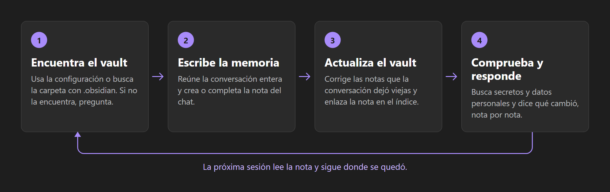
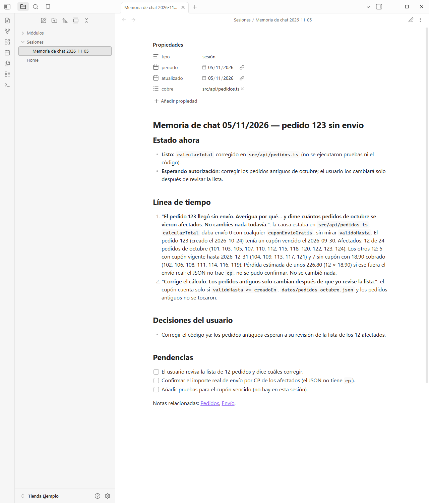
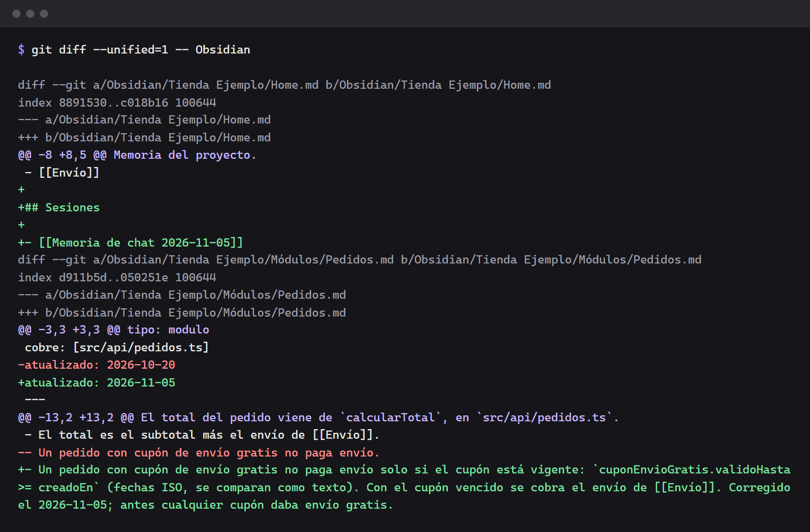
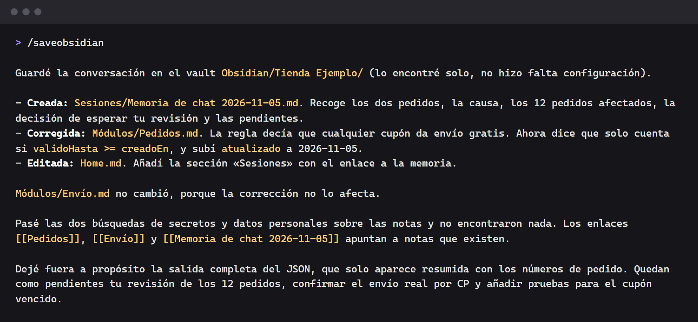

# `/saveobsidian` — guarda la conversación con la IA en tu Obsidian

[Português](README.md) · [English](README.en.md) · **Español**

La conversación con la IA termina, y lo que se decidió en ella se va también. Esta skill convierte el
chat en una nota de tu vault de **Obsidian**: lo que se pidió, lo que se hizo, lo que estaba mal y se
corrigió, lo que decidiste y lo que quedó pendiente. La próxima sesión lee la nota y sigue donde se
quedó.

Funciona en **cualquier proyecto**, en cualquier lenguaje. Es un solo archivo Markdown, sin
dependencias y sin configuración obligatoria.

> **Nota sobre el idioma:** las instrucciones de la skill están en portugués, y escribe la nota en el
> idioma de la conversación. En la prueba en español, la nota, la carpeta y el archivo salieron en
> español (`Sesiones/Memoria de chat 2026-11-05.md`), y los campos del frontmatter se quedaron en
> portugués (`periodo`, `atualizado`, `cobre`). Para fijar la carpeta, usa `pastaSessoes`.

## Instalar

Solo en este proyecto:

```bash
npx skills add AirtonDeodato07/skill-saveobsidian
```

En todos tus proyectos:

```bash
npx skills add AirtonDeodato07/skill-saveobsidian -g
```

`skills` pregunta para qué agente instalarla (Claude Code, Codex, Cursor y otros).

Sin Node, copia la carpeta `skills/saveobsidian` a `.claude/skills/` del proyecto, o a
`~/.claude/skills/` para usarla en todos. En Codex, el destino es `.agents/skills/`.

## Usar

Al final de la conversación, escribe:

```text
/saveobsidian
```

Frases como *"save this chat to the vault"* también funcionan, y son el camino en los agentes sin
comandos de barra.

Probada en Claude Code. En los otros agentes la instalación es la misma, pero su funcionamiento
todavía no se ha probado.

## Qué hace



1. **Encuentra el vault**: la configuración, si la hay, o la carpeta del proyecto que tiene
   `.obsidian/`. Si no la encuentra, pregunta y guarda la respuesta. Sin respuesta, no crea nada.
2. **Reúne la conversación entera**. Si el chat se resumió, recupera el comienzo del historial, sin
   inventar lo que falte.
3. **Encuentra o crea la nota del chat**. La nota de otra conversación del mismo día nunca se
   sobrescribe.
4. **Escribe la memoria**, siempre completa.
5. **Corrige las notas que la conversación dejó viejas**.
6. **Enlaza la nota en el índice**, para que no quede huérfana.
7. **Busca secretos y datos personales** en la nota antes de terminar.
8. **Dice qué cambió**, nota por nota.

## Cómo queda la nota

```markdown
---
tipo: sesión
periodo: 2026-11-05
atualizado: 2026-11-05
cobre: [src/api/pedidos.ts]
---

# Memoria de chat 05/11/2026 — pedido sin envío

## Estado ahora

- **Listo:** el envío vuelve a sumarse al total, en producción desde las 15 h.
- **Esperando autorización:** corregir los 12 pedidos antiguos.

## Línea de tiempo

1. **"El pedido 123 llegó sin envío"**: el total ignoraba el envío gratis vencido. Corregido en
   `src/api/pedidos.ts`. Medido: 12 pedidos afectados en octubre. Ver [[Pedidos]].

## Respuestas corregidas

- Primero dije que el error estaba en la pantalla. Era falso: la pantalla solo mostraba el total del
  servidor.

## Decisiones del usuario

- Los pedidos antiguos solo cambian después de que el usuario revise la lista.

## Pendientes

- [ ] Corregir los 12 pedidos antiguos.
- [x] Corregir la suma del envío.
```

## Ejemplos

Las imágenes vienen de una conversación real en Claude Code, en un proyecto ficticio, "Tienda
Ejemplo": el usuario pregunta por qué un pedido llegó sin envío, pide la corrección y escribe
`/saveobsidian`.

### La nota

La skill encontró el vault por sí sola, sin configuración, y creó la nota del chat.



### El resto del vault

La conversación dejó vieja la regla del envío en `Módulos/Pedidos.md`. La skill corrigió esa regla y
enlazó la nota nueva en `Home.md`.



### La respuesta

Al final, dice qué creó, qué corrigió y qué dejó fuera.



## Configuración (opcional)

Solo hace falta cuando el vault no está dentro del proyecto o cuando hay más de uno. Crea
`saveobsidian.config.json` en la raíz del proyecto:

```json
{
  "vault": "C:/Users/tu/Documents/Mi Vault",
  "pastaSessoes": "Proyectos/Tienda/Sesiones",
  "indice": "Home.md"
}
```

| Campo | Valor por defecto | Para qué sirve |
| --- | --- | --- |
| `vault` | obligatorio | carpeta del vault, relativa a la raíz del proyecto o absoluta |
| `pastaSessoes` | `Sessões`; `Sessões/<proyecto>` cuando el vault está fuera del proyecto | dónde quedan las memorias |
| `indice` | `Home.md`, `Índice.md`, `Index.md` o `README.md` | nota que enumera las memorias |

Una ruta absoluta solo existe en tu máquina: añade el archivo a `.gitignore`.

## Qué queda fuera

La nota es un registro, no una transcripción:

- **secretos**: token, clave, contraseña, cookie, cadena de conexión;
- **datos personales de terceros**: solo el nombre de pila y el número del pedido o del ticket, sin
  documento de identidad, teléfono, dirección, correo ni tarjeta;
- **salida completa de herramientas**: solo el número que importa, con la fecha de la medición.

La búsqueda de la skill cubre los formatos más comunes, pero no reconoce todos los secretos. Si el
vault está en un repositorio, revisa la nota antes del commit, sobre todo si el repositorio es
público.

## Junto con `atualizar-obsidian`

Esta skill funciona sola. Para mantener todo el vault al día, con una auditoría de notas atrasadas y
enlaces rotos, usa también
[`skill-atualizar-obsidian`](https://github.com/AirtonDeodato07/skill-atualizar-obsidian/blob/main/README.es.md).
`/saveobsidian` lee su configuración y la ejecuta cuando está instalada.

## Licencia

[MIT](LICENSE).
