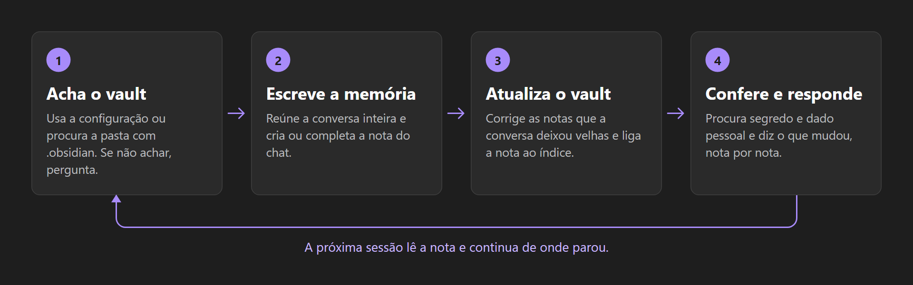
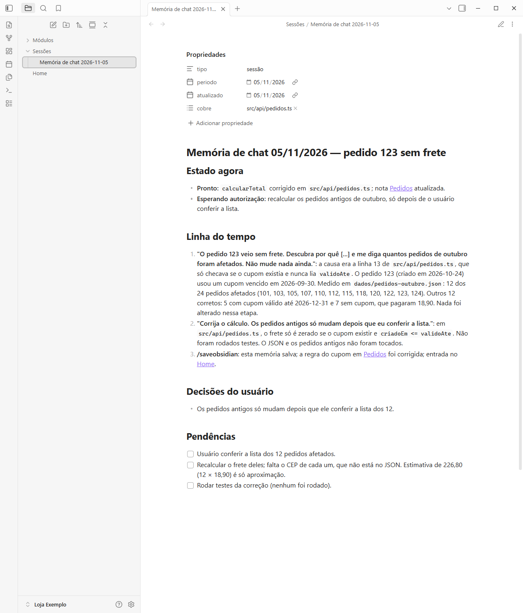
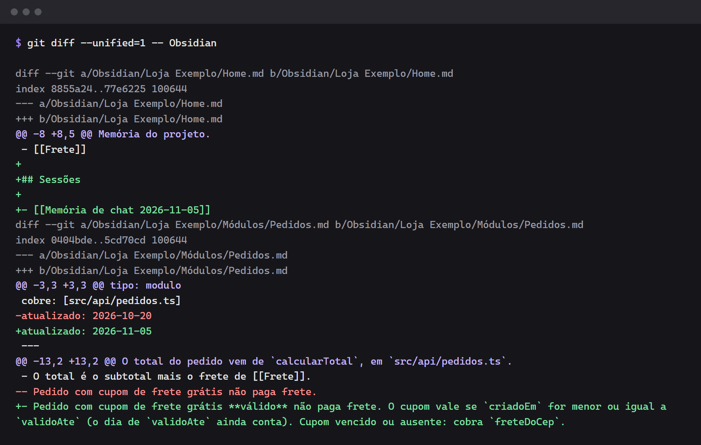
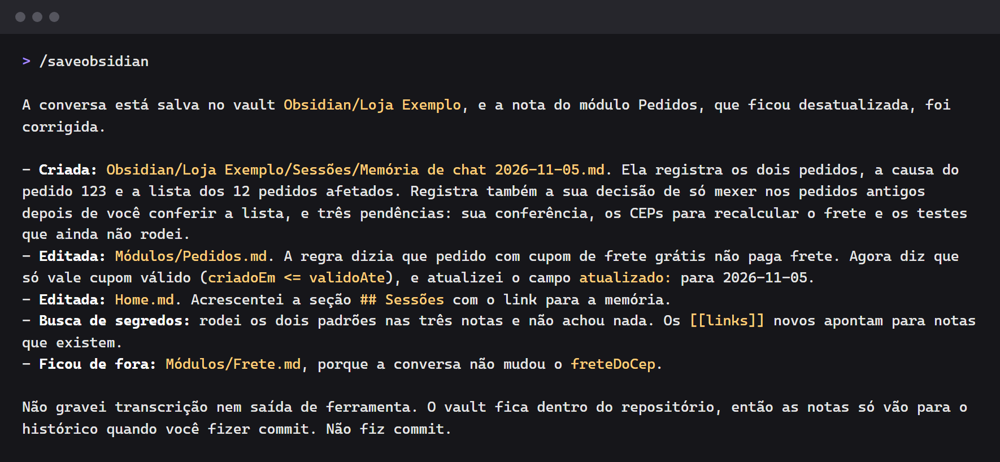

# `/saveobsidian` — salve a conversa com a IA no seu Obsidian

**Português** · [English](README.en.md) · [Español](README.es.md)

A conversa com a IA acaba, e o que foi decidido nela vai junto. Esta skill transforma o chat numa
nota do seu vault do **Obsidian**: o que foi pedido, o que foi feito, o que estava errado e foi
corrigido, o que você decidiu e o que ficou pendente. A próxima sessão lê a nota e continua de onde
parou.

Funciona em **qualquer projeto**, em qualquer linguagem. É um único arquivo Markdown, sem dependência
e sem configuração obrigatória.

## Instalar

Só neste projeto:

```bash
npx skills add AirtonDeodato07/skill-saveobsidian
```

Em todos os seus projetos:

```bash
npx skills add AirtonDeodato07/skill-saveobsidian -g
```

O `skills` pergunta para qual agente instalar (Claude Code, Codex, Cursor e outros).

Sem Node, copie a pasta `skills/saveobsidian` para `.claude/skills/` do projeto, ou para
`~/.claude/skills/` para valer em todos. No Codex, o destino é `.agents/skills/`.

## Usar

Ao fim da conversa, digite:

```text
/saveobsidian
```

Frases como *"salve a conversa no obsidian"* também funcionam, e são o caminho nos agentes sem
comando de barra.

Testada no Claude Code. Nos outros agentes a instalação é a mesma, mas o funcionamento ainda não foi
testado.

## O que ela faz



1. **Acha o vault**: a configuração, se houver, ou a pasta do projeto que tem `.obsidian/`. Se
   não achar, ela pergunta e guarda a resposta. Sem resposta, não cria nada.
2. **Reúne a conversa inteira**. Se o chat foi resumido, recupera o começo do histórico, sem inventar
   o que faltar.
3. **Acha ou cria a nota do chat**. A nota de outra conversa do mesmo dia nunca é sobrescrita.
4. **Escreve a memória**, sempre completa.
5. **Corrige as notas que a conversa deixou velhas**.
6. **Liga a nota ao índice**, para ela não ficar órfã.
7. **Procura segredo e dado pessoal** na nota antes de terminar.
8. **Diz o que mudou**, nota por nota.

## Como fica a nota

```markdown
---
tipo: sessão
periodo: 2026-11-05
atualizado: 2026-11-05
cobre: [src/api/pedidos.ts]
---

# Memória de chat 05/11/2026 — pedido sem frete

## Estado agora

- **Pronto:** o frete volta a somar no total, no ar desde as 15h.
- **Esperando autorização:** corrigir os 12 pedidos antigos.

## Linha do tempo

1. **"O pedido 123 veio sem frete"**: o total ignorava frete grátis vencido. Corrigido em
   `src/api/pedidos.ts`. Medido: 12 pedidos afetados em outubro. Ver [[Pedidos]].

## Respostas corrigidas

- Primeiro disse que o erro era na tela. Estava errado: a tela só mostrava o total do servidor.

## Decisões do usuário

- Os pedidos antigos só mudam depois de ele conferir a lista.

## Pendências

- [ ] Corrigir os 12 pedidos antigos.
- [x] Corrigir a soma do frete.
```

## Exemplos

As imagens vêm de uma conversa real no Claude Code, num projeto fictício, a "Loja Exemplo": o usuário
pergunta por que um pedido veio sem frete, pede a correção e digita `/saveobsidian`.

### A nota

A skill achou o vault sozinha, sem configuração, e criou a nota do chat.



### O resto do vault

A conversa deixou velha a regra do frete em `Módulos/Pedidos.md`. A skill corrigiu essa regra e ligou
a nota nova ao `Home.md`.



### A resposta

No fim, ela diz o que criou, o que corrigiu e o que deixou de fora.



## Configuração (opcional)

Só é preciso quando o vault não está dentro do projeto ou quando há mais de um. Crie
`saveobsidian.config.json` na raiz do projeto:

```json
{
  "vault": "C:/Users/voce/Documents/Meu Vault",
  "pastaSessoes": "Projetos/Loja/Sessões",
  "indice": "Home.md"
}
```

| Campo | Padrão | Para quê |
| --- | --- | --- |
| `vault` | obrigatório | pasta do vault, relativa à raiz do projeto ou absoluta |
| `pastaSessoes` | `Sessões`; `Sessões/<projeto>` quando o vault está fora do projeto | onde ficam as memórias |
| `indice` | `Home.md`, `Índice.md`, `Index.md` ou `README.md` | nota que lista as memórias |

Caminho absoluto é da sua máquina: ponha o arquivo no `.gitignore`.

## O que fica de fora

A nota é um registro, não uma transcrição:

- **segredo**: token, chave, senha, cookie, string de conexão;
- **dado pessoal de terceiros**: só primeiro nome e número do pedido ou do chamado, sem CPF, telefone,
  endereço, e-mail ou cartão;
- **saída de ferramenta inteira**: só o número que importa, com a data da medição.

A busca da skill procura os formatos mais comuns, mas não reconhece todo segredo. Se o vault está num
repositório, confira a nota antes do commit, ainda mais se o repositório for público.

## Junto com `atualizar-obsidian`

Esta skill funciona sozinha. Para manter o vault inteiro em dia, com auditoria de notas atrasadas e
links quebrados, use também a
[`skill-atualizar-obsidian`](https://github.com/AirtonDeodato07/skill-atualizar-obsidian). A
`/saveobsidian` lê a configuração dela e a roda quando está instalada.

## Licença

[MIT](LICENSE).
